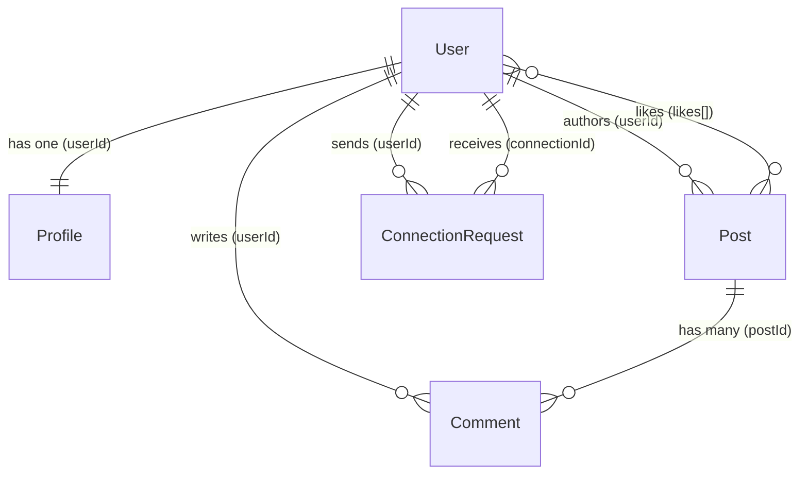

# ConnectIn — Full-Stack LinkedIn Clone

**ConnectIn** is a full-stack professional networking web application built with **Next.js (Pages Router)**, **Redux Toolkit**, **Express**, and **MongoDB**. It provides a responsive LinkedIn-style interface covering user authentication, a community feed with media posts, likes and inline comments, member discovery with debounced search, connection requests, editable career profiles, and one-click PDF resume generation.

---

## Tech Stack

### Frontend (`/frontend`)
- **Framework**: Next.js `15.2.2` (Pages Router) & React `19.0.0`
- **State Management**: Redux Toolkit (`^2.6.1`) & React Redux (`^9.2.0`)
- **HTTP Client**: Axios (`^1.8.4`)
- **Styling**: CSS Modules & global CSS design tokens (`#0a66c2`, `#f3f2ef`, responsive breakpoints)
- **Linting**: ESLint `^9` with `eslint-config-next`

### Backend (`/backend`)
- **Runtime & Framework**: Node.js (ES Modules) & Express `^4.21.2`
- **Database & ODM**: MongoDB (`^6.14.2`) & Mongoose (`^8.12.1`)
- **Authentication & Security**: `bcrypt` password hashing, `crypto` random session tokens, `cors`
- **Media Storage**: `multer` + `multer-storage-cloudinary` (Cloudinary)
- **PDF Generation**: `pdfkit` (`^0.16.0`)

---

## Features

- **Landing & Authentication (`/`, `/login`)**
  - LinkedIn-style landing page and centered Sign In / Sign Up cards.
  - Client-side pre-flight form validation (`validateLoginForm`, `validateRegisterForm`) before dispatching API requests.
  - Loading states on action buttons to prevent duplicate submissions.
- **Community Feed (`/dashboard`)**
  - 3-column responsive layout (user summary card & navigation shortcuts on the left, feed in the center, member recommendations on the right, and a fixed mobile bottom navigation bar).
  - Create text and image posts with live attachment preview (`POST /post`).
  - Toggle likes (`POST /increment_post_like`), expand inline comments (`GET /get_comments`, `POST /comment`), copy post links, and delete your own posts with inline confirmation (`DELETE /delete_post`).
  - Shimmer skeleton loaders while posts are fetching.
- **Discover People (`/discover`)**
  - Member directory grid with client-side debounced search (`useDebounce`, 300ms) across names, usernames, and current roles.
- **My Network (`/my_connections`)**
  - View incoming pending connection requests, accept invitations (`POST /user/accept_connection_request`), and browse accepted network connections.
- **Personal Profile (`/profile`)**
  - Edit display name, current role/headline, and bio (`POST /user_update`, `POST /update_profile_data`).
  - Upload/update profile picture (`POST /update_profile_picture`).
  - Add **Work History** and **Education** entries via validated modals, and review your recent activity.
- **Public Profile & Resume Export (`/view_profile/[username]`)**
  - Server-side rendered public member profile (`getServerSideProps`) with `Pending` / `Connected` / `Connect` status.
  - One-click PDF resume download (`GET /user/download_resume`) generated dynamically via `pdfkit`.

---

## Project Structure

```text
Linkedin_Clone/
├── .env                          # Environment variables for backend (DB & Cloudinary)
├── .gitignore
├── README.md
├── backend/
│   ├── server.js                 # Express app entry point (port 9080)
│   ├── package.json
│   ├── controllers/
│   │   ├── posts.controller.js   # Post, like, and comment handlers
│   │   └── user.controller.js    # Auth, profile, connections, and PDF resume handlers
│   ├── models/
│   │   ├── user.model.js         # User schema
│   │   ├── profile.model.js      # Profile, workSchema, educationSchema
│   │   ├── posts.model.js        # Post schema + cascade comment cleanup hooks
│   │   ├── comments.model.js     # Comment schema
│   │   └── connection.model.js   # ConnectionRequest schema
│   ├── routes/
│   │   ├── posts.routes.js       # Post & comment endpoints + Cloudinary upload
│   │   └── user.routes.js        # User, profile, network & resume endpoints
│   └── uploads/                  # Generated PDF resumes served statically
└── frontend/
    ├── package.json
    ├── next.config.mjs
    ├── eslint.config.mjs
    ├── public/                   # Favicons and static assets
    └── src/
        ├── config/
        │   ├── index.jsx         # Axios clientServer & getApiError helper
        │   └── redux/
        │       ├── store.js
        │       ├── action/       # authAction, postAction
        │       └── reducer/      # authReducer, postReducer
        ├── Components/
        │   ├── Common/           # BrandLogo, Button, Skeleton, UserAvatar
        │   └── Navbar/           # Global top navigation bar
        ├── hooks/
        │   └── useDebounce.js
        ├── layout/
        │   ├── userLayout/       # Header wrapper
        │   └── dashboardLayout/  # 3-column authenticated shell & mobile bottom nav
        ├── pages/
        │   ├── index.jsx         # Landing page (/)
        │   ├── login/            # Sign In / Sign Up (/login)
        │   ├── dashboard/        # Main feed (/dashboard)
        │   ├── discover/         # Searchable member directory (/discover)
        │   ├── my_connections/   # Invitations & network (/my_connections)
        │   ├── profile/          # Editable personal profile (/profile)
        │   └── view_profile/     # SSR public profile & PDF resume (/view_profile/[username])
        ├── styles/
        │   ├── globals.css       # Design tokens & base resets
        │   └── Home.module.css
        └── utils/
            └── validation.js     # Pre-flight form validation helpers
```

---

## Prerequisites

- **Node.js** `v18+` (tested on `v22.17.0`)
- **MongoDB** connection string (local or MongoDB Atlas)
- **Cloudinary** account (for profile picture and post media uploads)

---

## Environment Configuration

Create a `.env` file in the **project root** (`Linkedin_Clone/.env`) for the backend:

```env
DB_URL=your_mongodb_connection_string
CLOUD_NAME=your_cloudinary_cloud_name
CLOUD_API_KEY=your_cloudinary_api_key
CLOUD_API_SECRET=your_cloudinary_api_secret
```

Optionally, create `frontend/.env.local` if your backend runs on a non-default URL (defaults to `http://localhost:9080`):

```env
NEXT_PUBLIC_API_URL=http://localhost:9080
```

---

## Getting Started

### 1. Start the Backend Server

```bash
cd backend
npm install
npm run dev
```

- Uses `nodemon server.js` for development (`npm run prod` runs `node server.js`).
- Connects to MongoDB via `DB_URL` and listens on **`http://localhost:9080`**.

### 2. Start the Frontend App

Open a separate terminal:

```bash
cd frontend
npm install
npm run dev
```

- Runs Next.js development server on **`http://localhost:3000`**.

### Other Frontend Scripts

```bash
cd frontend
npm run lint    # Run ESLint checks
npm run build   # Create optimized production build
npm run start   # Start production Next.js server
```

---

## Database Schema (MongoDB / Mongoose)

The backend defines five Mongoose models in `backend/models/` with relational references to `User` and `Post`, plus cascade-delete hooks on `Post` removal.



### 1. `User` (`backend/models/user.model.js`)

| Field | Type | Constraints / Default | Description |
| :--- | :--- | :--- | :--- |
| `name` | `String` | `required: true` | User's full display name |
| `username` | `String` | `required: true`, `unique: true` | Unique handle |
| `email` | `String` | `required: true`, `unique: true` | Unique login email |
| `password` | `String` | `required: true` | `bcrypt`-hashed password |
| `active` | `Boolean` | `default: true` | Account active flag |
| `profilePicture` | `String` | `default: "default.jpg"` | Uploaded avatar filename |
| `profilePictureUrl` | `String` | Cloudinary default avatar URL | Public avatar URL |
| `token` | `String` | `default: ""` | Active session token (`crypto`) |
| `createdAt` | `Date` | `default: Date.now` | Account creation timestamp |

### 2. `Profile` (`backend/models/profile.model.js`)

| Field | Type | Constraints / Default | Description |
| :--- | :--- | :--- | :--- |
| `userId` | `ObjectId` | `ref: "User"` | Owner user reference |
| `bio` | `String` | `default: ""` | About / summary text |
| `currentPosition` | `String` | `default: ""` | Current role or headline |
| `pastWork` | `[workSchema]` | `default: []` | Array of work experience entries |
| `education` | `[educationSchema]` | `default: []` | Array of education entries |

- **`workSchema` (embedded)**: `company` (`String`, `default: ""`), `position` (`String`, `default: ""`), `years` (`String`, `default: ""`)
- **`educationSchema` (embedded)**: `school` (`String`, `default: ""`), `degree` (`String`, `default: ""`), `fieldOfStudy` (`String`, `default: ""`)

### 3. `Post` (`backend/models/posts.model.js`)

| Field | Type | Constraints / Default | Description |
| :--- | :--- | :--- | :--- |
| `userId` | `ObjectId` | `ref: "User"` | Post author |
| `body` | `String` | `required: true`, `trim: true` | Post text content |
| `likes` | `[ObjectId]` | `ref: "User"`, `default: []` | Users who liked the post |
| `media` | `String` | `default: ""` | Uploaded media filename |
| `mediaUrl` | `String` | — | Cloudinary media URL |
| `fileType` | `String` | `default: ""` | Media subtype (e.g. `png`, `jpeg`) |
| `active` | `Boolean` | `default: true` | Visibility/active flag |
| `createdAt` | `Date` | `default: Date.now` | Creation timestamp |
| `updatedAt` | `Date` | `default: Date.now` | Last update timestamp |

- **Middleware Hooks**: `pre('deleteOne')` and `pre('remove')` automatically delete all `Comment` documents matching `postId`.

### 4. `Comment` (`backend/models/comments.model.js`)

| Field | Type | Constraints / Default | Description |
| :--- | :--- | :--- | :--- |
| `userId` | `ObjectId` | `ref: "User"` | Comment author |
| `postId` | `ObjectId` | `ref: "Post"` | Target post reference |
| `body` | `String` | `required: true` | Comment text |

### 5. `ConnectionRequest` (`backend/models/connection.model.js`)

| Field | Type | Constraints / Default | Description |
| :--- | :--- | :--- | :--- |
| `userId` | `ObjectId` | `ref: "User"` | Request sender |
| `connectionId` | `ObjectId` | `ref: "User"` | Request recipient |
| `status_accepted` | `Boolean` | `default: null` | `null` = pending, `true` = accepted, `false` = rejected |

---

## API Reference

### User, Profile & Connections (`/backend/routes/user.routes.js`)

| Method | Endpoint | Description |
| :--- | :--- | :--- |
| `POST` | `/register` | Register a new user and initialize empty profile |
| `POST` | `/login` | Authenticate user and return session token |
| `POST` | `/user_update` | Update user account details (`name`, etc.) |
| `GET` | `/get_user_and_proflie` | Fetch authenticated user and profile by `token` query |
| `POST` | `/update_profile_data` | Update `bio`, `currentPosition`, `pastWork`, and `education` |
| `POST` | `/update_profile_picture` | Upload profile picture (`profile_picture` multipart field) |
| `GET` | `/user/get_all_users` | Retrieve all user profiles |
| `GET` | `/user/get_User_Profile_Based_On_Username` | Fetch a public profile by `username` query |
| `GET` | `/user/download_resume` | Generate PDF resume by `id` query and return filename |
| `POST` | `/user/send_connection_request` | Send a connection request to `connectionId` |
| `GET` | `/user/getConnectionRequests` | List outgoing connection requests |
| `GET` | `/user/user_connection_request` | List incoming connection requests & accepted connections |
| `POST` | `/user/accept_connection_request` | Accept or reject a connection request |

### Posts & Comments (`/backend/routes/posts.routes.js`)

| Method | Endpoint | Description |
| :--- | :--- | :--- |
| `GET` | `/` | Health check (`{ message: "Running" }`) |
| `POST` | `/post` | Create a post with optional `media` image upload |
| `GET` | `/posts` | Fetch all posts populated with author details |
| `DELETE` | `/delete_post` | Delete a post (author-only) and cascade-delete its comments |
| `POST` | `/increment_post_like` | Toggle like on a post for the authenticated user |
| `POST` | `/comment` | Add a comment to a post |
| `GET` | `/get_comments` | Fetch comments for a `post_id` |
| `DELETE` | `/delete_comment` | Delete a comment (author-only) |
